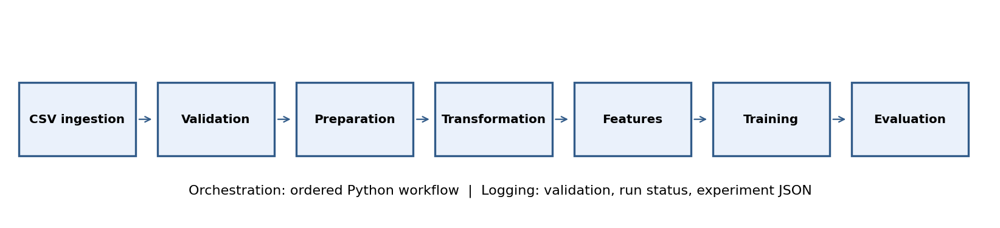

# End-to-End Movie Recommendation Data Management Pipeline

BITS Pilani AIML ZG529 — Data Management for Machine Learning. Reproducible offline assignment project.

## Setup (Python 3.10+)

```bash
python -m venv .venv
# Windows: .venv\Scripts\activate
# macOS/Linux: source .venv/bin/activate
pip install -r requirements.txt
python dags/workflow.py
python -m pytest -q
```

To run a single stage, use `python src/pipeline.py --stage validation` (upstream files must exist). The workflow runner is a **structured Python orchestrator**, explicitly allowed by the assignment, not an Airflow DAG. It executes dependent stages in order and aborts if a stage fails. On Windows, schedule `python dags/workflow.py` using Task Scheduler; on Linux, cron can schedule it. The included screenshot is of an actual successful local run, not a scheduler dashboard.

## Architecture



`Synthetic CSV source -> validation and quarantine -> chronological split -> transformations -> persisted features -> popularity + item-CF -> top-K evaluation -> JSON experiment logs`

## Data and design

The source is a **deterministic synthetic dataset**, generated locally by `src/pipeline.py` with NumPy seed 529: 100 users, 80 movies, 3,600 valid user-item rating events, and 7 intentionally corrupted extra rows. Each user interacts with 36 distinct items, with genre-correlated preferences and dates in 2025. Ratings are integers from 1 to 5. The data is synthetic, **not MovieLens**. This avoids external downloads and enables reliable re-runs.

Validation checks missing values, duplicate records, numeric ID/rating types, rating range, UTC timestamps, and user/item foreign keys. Invalid interactions are quarantined in `data/errors/invalid_interactions.csv` with explicit reasons; user and item dimensions are checked for missing values and duplicate IDs. Outputs include `reports/validation_report.json`.

A per-user **chronological 80/20 split** prevents a user's future ratings from entering that user's training history. Aggregated user and item features use only training data. This is a per-user temporal evaluation rather than one global cutoff, a limitation to note when interpreting deployment readiness.

The baseline ranks unseen items by `training_rating_count * training_mean_rating / 5`. Personalized item-based collaborative filtering computes cosine similarities between binary item-interaction columns and predicts item scores using a similarity-weighted average of the user's observed ratings. Neither model recommends already-seen items.

Evaluation uses K=5; relevant means test rating >=4. Only users with at least one relevant test item are evaluated. Precision@5 is hits/5; Recall@5 is hits/relevant count; NDCG@5 uses log-discounted gains normalized by ideal DCG; Coverage is the fraction of all catalog items recommended at least once; Diversity is the mean fraction of pairs in a user's top-five list having different genres. **RMSE and MAE are not applicable**, because the models are evaluated as top-K rankers rather than explicit rating predictors. Both models use the same users, candidate universe, and held-out labels.

## Output files

- `data/raw/`: generated source CSVs; `data/processed/`: validated interactions, train/test, summaries, matrix.
- `data/features/`: reusable feature CSVs; `reports/feature_catalog.md`: definitions.
- `data/errors/`: quarantined invalid interactions.
- `models/`: popularity CSV, collaborative filtering NPZ, config JSON.
- `reports/model_comparison.csv`, `reports/recommendations.csv`: real measured outputs.
- `reports/experiment_*.json`: **custom file-based experiment tracking** of parameters, metrics, artifact paths, run IDs. MLflow is not installed or used; this satisfies the alternative tracking-tool option.
- `reports/workflow_run.json`, `reports/pipeline.log`, `reports/workflow_success.png`: orchestration evidence.
- `reports/final_report.pdf`: 3-page project report.

## Repository layout

```text
configs/                  configuration
src/pipeline.py           pipeline implementation and CLI
src/{ingestion,validation,preparation,transformation,features,training,evaluation}/
                          stage import interfaces
dags/workflow.py          workflow entry point
models/                   trained artifacts
reports/                  results, evidence, diagram, PDF
tests/                   pytest checks
```

## Experiment reproducibility and limitations

The random seed and generated input files are stable. JSON run timestamps and durations vary. There is no real-world cold-start study, no online A/B test, no production scheduler, and no drift monitoring. Synthetic genre preferences may exaggerate the effectiveness of collaborative filtering. For a production upgrade, replace synthetic ingestion with a public dataset, adopt a global temporal cutoff and a versioned feature store, and connect a workflow scheduler and model registry.

## Submission

Create a GitHub repository, upload these project files (do not upload `.venv`), and submit the repository URL plus `reports/final_report.pdf`. The archive is ready to upload, but the repository itself must be created in your GitHub account.
